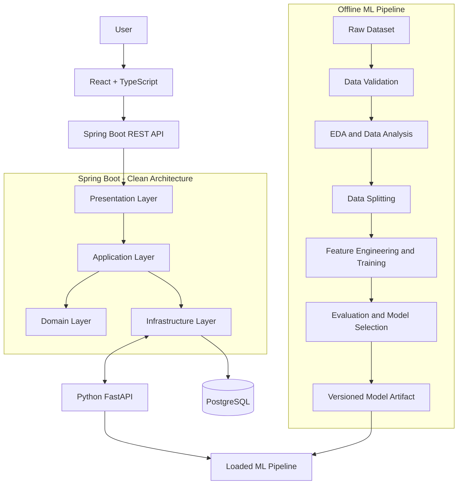
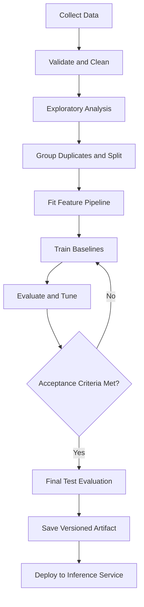

# MailSentry — Email Spam Detection Platform

**An end-to-end Machine Learning project combining Data Science, ML Engineering, Clean Architecture, and Full-Stack Development.**

MailSentry is an email spam classification platform that predicts whether a message is spam or legitimate. The project covers the complete machine learning lifecycle, from data collection and exploratory analysis to model evaluation, API integration, persistence, and a web-based user interface.

The goal is to build a reproducible, testable, maintainable, and deployable application—not merely a machine learning notebook.

> **Project status:** Architecture and implementation plan. Performance metrics, supported datasets, and production-readiness claims will be added only after verification.

---

## 1. Project Objectives

- Build a complete data processing and machine learning pipeline.
- Understand and document the dataset before model development.
- Compare baseline and improved classification models.
- Prevent data leakage and evaluate generalization on unseen data.
- Serve predictions through a dedicated Python API.
- Implement business logic using Spring Boot and Clean Architecture.
- Develop a responsive interface with React and TypeScript.
- Persist prediction metadata and support operational monitoring.
- Automate testing and quality checks through CI.
- Package the application using Docker.

### Core functionality

1. Submit a message for classification.
2. Receive a `SPAM` or `NOT_SPAM` prediction.
3. Display a model score when supported by the model's probability estimates.
4. Retrieve previous prediction records when persistence is enabled.
5. View model evaluation metrics and dataset statistics.
6. Track model versions and inference errors.

**Scope:** The initial release focuses on spam classification. It does not claim to detect every phishing attack, malicious attachment, or fraudulent email.

---

## 2. Technology Stack

| Component | Technology | Responsibility |
|---|---|---|
| Data processing | Python, Pandas, NumPy | Data manipulation and analysis |
| Visualization | Matplotlib, Seaborn | Exploratory data analysis |
| ML | scikit-learn | Feature extraction, training, evaluation |
| Model serialization | Joblib | Persisting fitted ML pipelines |
| ML API | FastAPI, Pydantic | Model inference and request validation |
| Backend | Java, Spring Boot | Application logic and REST APIs |
| Persistence | PostgreSQL, Spring Data JPA | Prediction metadata and application data |
| Migrations | Flyway | Versioned database schema changes |
| Frontend | React, TypeScript, Vite | User interface and client-side interactions |
| UI styling | Tailwind CSS | Responsive design and component styling |
| API testing | JUnit, Mockito, Testcontainers, pytest | Unit and integration tests |
| Frontend testing | Vitest, React Testing Library | Component and UI behavior tests |
| API documentation | OpenAPI | Documented HTTP contracts |
| Containerization | Docker, Docker Compose | Reproducible local environments |
| CI | GitHub Actions | Automated tests and quality checks |

Dependencies should be pinned or locked, and versions should be recorded as the project is implemented.

---

## 3. High-Level System Architecture



### Architectural principles

- **Separation of concerns:** each component has a clear responsibility.
- **Dependency inversion:** business rules depend on abstractions, not database or network implementations.
- **Reproducibility:** model training and evaluation can be repeated using documented configurations.
- **Stateless inference:** the ML API does not need to retain individual requests in memory.
- **Versioned artifacts:** the deployed model is identifiable and traceable to its training process.
- **Defense in depth:** validate input at the API boundary and handle failures at each service boundary.

---

## 4. Repository Structure

```text
Email-Spam-Detector/
│
├── ml-pipeline/
│   ├── data/
│   │   ├── raw/
│   │   ├── interim/
│   │   └── processed/
│   ├── notebooks/
│   │   └── 01_exploratory_data_analysis.ipynb
│   ├── configs/
│   │   └── config.yaml
│   ├── src/
│   │   └── mailsentry_ml/
│   │       ├── data/
│   │       │   ├── ingestion.py
│   │       │   └── validation.py
│   │       ├── features/
│   │       │   └── text_features.py
│   │       ├── training/
│   │       │   ├── train.py
│   │       │   └── tune.py
│   │       ├── evaluation/
│   │       │   └── evaluate.py
│   │       └── artifacts/
│   ├── tests/
│   ├── pyproject.toml
│   └── README.md
│
├── ml-service/
│   ├── app/
│   │   ├── api/
│   │   │   └── routes.py
│   │   ├── schemas/
│   │   │   └── prediction.py
│   │   ├── inference/
│   │   │   └── predictor.py
│   │   ├── config.py
│   │   └── main.py
│   ├── artifacts/
│   ├── tests/
│   └── pyproject.toml
│
├── backend/
│   ├── src/
│   │   ├── main/
│   │   │   ├── java/com/anestouati/mailsentry/
│   │   │   │   ├── domain/
│   │   │   │   │   ├── model/
│   │   │   │   │   ├── exception/
│   │   │   │   │   └── port/
│   │   │   │   ├── application/
│   │   │   │   │   ├── usecase/
│   │   │   │   │   └── dto/
│   │   │   │   ├── infrastructure/
│   │   │   │   │   ├── persistence/
│   │   │   │   │   ├── mlclient/
│   │   │   │   │   └── configuration/
│   │   │   │   └── presentation/
│   │   │   │       ├── controller/
│   │   │   │       ├── request/
│   │   │   │       └── response/
│   │   │   └── resources/
│   │   │       ├── application.yml
│   │   │       └── db/migration/
│   │   └── test/
│   └── pom.xml
│
├── frontend/
│   ├── src/
│   │   ├── app/
│   │   ├── components/
│   │   │   ├── ui/
│   │   │   └── layout/
│   │   ├── features/
│   │   │   ├── prediction/
│   │   │   │   ├── components/
│   │   │   │   ├── hooks/
│   │   │   │   ├── api/
│   │   │   │   ├── types/
│   │   │   │   └── pages/
│   │   │   └── dashboard/
│   │   ├── lib/
│   │   ├── routes/
│   │   ├── styles/
│   │   └── main.tsx
│   ├── public/
│   ├── tests/
│   ├── package.json
│   └── vite.config.ts
│
├── docs/
│   ├── architecture.md
│   ├── data-dictionary.md
│   ├── model-card.md
│   ├── api-contracts.md
│   └── decisions/
│
├── .github/
│   └── workflows/
│       └── ci.yml
├── docker-compose.yml
├── .env.example
├── .gitignore
├── LICENSE
└── README.md
```

This is the target structure. Create files as their corresponding features are implemented rather than filling the repository with empty files.

---

## 5. Machine Learning Pipeline

The ML pipeline is the first component to implement.

### Stage 1 — Data collection

Start with the [Apache SpamAssassin Public Corpus](https://spamassassin.apache.org/old/publiccorpus/).

Responsibilities:

- Record the original source and license.
- Preserve original labels and source identifiers.
- Extract message text and relevant email fields.
- Record ingestion date and dataset version.
- Avoid committing private or unnecessarily large raw datasets to Git.

Potential initial data schema:

| Field | Description |
|---|---|
| `message_id` | Stable identifier where available |
| `source_id` | Identifier from the source corpus |
| `text` | Message content used for classification |
| `label` | Target label: `SPAM` or `NOT_SPAM` |
| `source` | Dataset origin |

The actual schema must be adapted to the chosen corpus.

### Stage 2 — Data validation

Validate:

- Required fields and data types.
- Empty or malformed messages.
- Invalid labels.
- Exact duplicates and repeated source identifiers.
- Class distribution and missing data.
- Character encoding and unexpected parsing failures.

Generate a quality report containing the number of accepted and rejected records and the reason for each rejection category.

### Stage 3 — Exploratory Data Analysis

Analyze:

- Number of spam and legitimate messages.
- Class imbalance.
- Message-length distributions.
- Vocabulary size and frequent terms.
- Duplicate messages.
- Common URLs, punctuation patterns, and unusual formatting.
- Differences between training and held-out data.

Visualizations should answer specific questions rather than exist only for presentation.

### Stage 4 — Data splitting

Create separate training, validation, and test sets.

A possible initial split is:

- 70% training.
- 15% validation.
- 15% test.

Use stratification where appropriate. Group exact or near-duplicate messages before splitting to reduce data leakage.

Fit vocabulary extraction, TF-IDF weights, and other learned transformations on training data only. The validation set supports model and threshold selection; the test set is reserved for final evaluation.

### Stage 5 — Preprocessing and feature engineering

Initial techniques:

- Unicode and whitespace normalization where justified.
- Consistent handling of missing or empty text.
- TF-IDF word n-grams.
- Optional character n-grams for obfuscated text.
- Optional numeric features, such as message length or URL count.

Do not automatically remove all punctuation, numbers, or URLs. These may contain useful signals for spam classification.

Use a scikit-learn `Pipeline` to ensure the same transformations are applied during training and inference.

### Stage 6 — Baseline models

Implement and compare:

1. **Multinomial Naive Bayes:** fast probabilistic baseline for sparse text features.
2. **Logistic Regression:** strong linear baseline with useful interpretability properties.

Potential experiments:

- Word-level versus character-level TF-IDF.
- Unigram versus bigram features.
- Regularization strength.
- Class weights.
- Decision thresholds.

Record the dataset version, split strategy, feature configuration, hyperparameters, and evaluation metrics for each experiment.

### Stage 7 — Evaluation and model selection

Use:

- Precision.
- Recall.
- F1-score.
- Confusion matrix.
- Precision-recall curve and PR-AUC.
- Accuracy as a supplementary metric.
- Inference latency and artifact size where relevant.

False positives matter because legitimate emails may be marked as spam. False negatives matter because unwanted messages may pass through.

Select the operating threshold according to these trade-offs and the intended application.

Do not assume that a raw model score is a calibrated probability. If probability calibration is required, fit and evaluate calibration using training/validation data without touching the final test set.

### Stage 8 — Artifact creation

Persist the complete fitted preprocessing-and-classification pipeline, not just the classifier.

Each model release should record:

- Model version.
- Training dataset version.
- Feature configuration.
- Hyperparameters.
- Evaluation metrics.
- Training code version or Git commit.
- Known limitations.

Only promote a model to deployment after it passes the agreed evaluation and validation checks.

### Pipeline workflow



---

## 6. Python Inference Service

The training pipeline and inference API are separate components.

### Responsibilities

- Load an approved model artifact at startup.
- Validate incoming requests.
- Apply the exact preprocessing pipeline used during training.
- Return a classification result and model version.
- Return a probability only when supported and appropriately interpreted.
- Expose a health endpoint.
- Handle model-loading and inference errors without leaking stack traces or message contents.

### Suggested endpoints

| Method | Endpoint | Purpose |
|---|---|---|
| `GET` | `/health` | Check service health |
| `GET` | `/internal/v1/model-info` | Report loaded model version |
| `POST` | `/internal/v1/predict` | Classify a message |

### Example request

```json
{
  "message": "Congratulations! Claim your prize now."
}
```

### Example response

```json
{
  "prediction": "SPAM",
  "score": 0.94,
  "modelVersion": "1.0.0"
}
```

The score is illustrative. In the actual implementation, document whether it is a calibrated probability or another model score.

The internal ML API should not be directly exposed to the public internet. Spring Boot should call it through a configured internal address with appropriate timeouts and error handling.

---

## 7. Spring Boot — Clean Architecture

Spring Boot manages the application and communicates with the ML service.

### 7.1 Domain layer

Contains core business concepts and rules, independent of Spring, HTTP, and the database.

Possible components:

- `Prediction`
- `PredictionLabel`
- `PredictionId`
- `ModelVersion`
- `PredictionPolicy`
- Domain exceptions

The domain should not import Spring Data JPA or FastAPI client libraries.

### 7.2 Application layer

Coordinates use cases and defines ports.

Example use cases:

- `ClassifyMessageUseCase`
- `GetPredictionUseCase`
- `GetPredictionHistoryUseCase`

Example ports:

- `PredictionModelPort` — request inference from a model provider.
- `PredictionRepository` — persist and retrieve prediction records.

The application layer defines what it needs. Infrastructure implements those interfaces.

### 7.3 Infrastructure layer

Contains technical implementations:

- `FastApiPredictionAdapter` — implements `PredictionModelPort`.
- `JpaPredictionRepositoryAdapter` — implements `PredictionRepository`.
- JPA entities and Spring Data repositories.
- HTTP client configuration.
- Database migrations.
- Dependency-injection configuration.

Keep persistence entities separate from domain objects when this separation materially helps maintainability.

### 7.4 Presentation layer

Contains:

- REST controllers.
- Request and response DTOs.
- Bean Validation rules.
- Global exception handling.
- API documentation.

Controllers should remain thin: validate the request, call a use case, and translate the result into an HTTP response.

### Prediction request workflow

1. React submits a request to Spring Boot.
2. The controller validates the request.
3. The application use case applies business rules.
4. The use case calls `PredictionModelPort`.
5. The infrastructure adapter sends the message to FastAPI.
6. FastAPI runs the loaded ML pipeline.
7. Spring Boot maps the result into a domain prediction.
8. The repository persists permitted prediction metadata.
9. Spring Boot returns a response DTO to React.

### Failure handling

- Invalid input: `400 Bad Request`.
- Missing prediction record: `404 Not Found`.
- ML service timeout or unavailability: `503 Service Unavailable` or another documented transient-service response.
- Unexpected server error: generic error response with a trace/request ID.

Never return internal stack traces or secrets to clients.

---

## 8. PostgreSQL Data Model

Start with a minimal `predictions` table.

| Column | Purpose |
|---|---|
| `id` | Unique prediction identifier |
| `label` | `SPAM` or `NOT_SPAM` |
| `score` | Nullable score or calibrated probability |
| `model_version` | Model used for prediction |
| `created_at` | Prediction timestamp |
| `request_id` | Request tracing identifier |

Do not store the full email body by default. If message history is a product requirement, define a retention policy, restrict access, and provide appropriate disclosure and deletion controls.

Use Flyway for versioned schema migrations. Add indexes only when supported by actual query patterns.

---

## 9. React Frontend Architecture

Organize React by **features**, not by placing every component into a single directory.

### Main screens

**1. Prediction page**

- Message input area.
- Character count and validation.
- Loading indicator.
- Prediction result.
- Model score, with an explanation of its meaning.
- Error and retry states.

**2. Dashboard**

- Dataset and evaluation metrics.
- Model version and release information.
- Confusion matrix and precision-recall results.
- Clearly distinguish offline test metrics from live production statistics.

**3. History page**

- Recent prediction records.
- Label and timestamp filters.
- Pagination.
- Record details, if enabled.

### Frontend module responsibilities

- `components/ui/`: reusable visual primitives.
- `components/layout/`: navigation, header, page layout.
- `features/prediction/api/`: calls to the Spring Boot API.
- `features/prediction/hooks/`: request and UI state management.
- `features/prediction/types/`: TypeScript request and response types.
- `features/prediction/components/`: input and result components.
- `features/dashboard/`: metrics and charts.
- `lib/`: shared utilities and API client configuration.
- `routes/`: application navigation.

Use React state for form and request states, reusable typed components, and accessible form controls. Keep API calls out of presentation components where possible.

### Frontend workflow

1. User enters a message.
2. Client validates required input and length.
3. React sends the request to Spring Boot.
4. The UI displays a loading state.
5. The response is validated and rendered.
6. Errors are shown in a useful, nontechnical form.
7. The user may submit another message or open the history page.

The frontend must never communicate directly with PostgreSQL or access the serialized model artifact.

---

## 10. API Contract

### Public Spring Boot endpoints

| Method | Endpoint | Purpose |
|---|---|---|
| `GET` | `/api/v1/health` | Application health |
| `POST` | `/api/v1/predictions` | Classify a message |
| `GET` | `/api/v1/predictions/{id}` | Retrieve a prediction |
| `GET` | `/api/v1/predictions` | Retrieve paginated history |
| `GET` | `/api/v1/metrics` | Return approved model evaluation metrics |

### Example public request

```json
{
  "message": "Congratulations! Claim your prize now."
}
```

### Example public response

```json
{
  "id": "example-id",
  "prediction": "SPAM",
  "score": 0.94,
  "modelVersion": "1.0.0",
  "createdAt": "2027-01-01T12:00:00Z"
}
```

All example values are placeholders, not measured project results.

Use consistent DTOs, explicit validation, pagination limits, and a documented error schema. Keep the internal FastAPI contract separate from the public API so the backend can evolve independently.

---

## 11. Testing Strategy

### Machine learning

- Data validation tests.
- Tests for empty and malformed messages.
- Leakage and split-integrity checks.
- Deterministic training tests where appropriate.
- Metric calculation tests.
- Model artifact loading and prediction tests.
- Regression tests for representative examples.

### Spring Boot

- Domain unit tests.
- Use-case tests using mocked ports.
- Controller and validation tests.
- Integration tests for persistence.
- HTTP client tests for ML-service errors and timeouts.
- API contract tests.

### React

- Form validation tests.
- Loading, success, and error state tests.
- Prediction result rendering tests.
- API-client tests.
- Accessible interaction tests.

### End-to-end

Test the complete flow:

`React → Spring Boot → FastAPI → Model → PostgreSQL → Response`

Use Docker Compose or a dedicated test environment to exercise service boundaries. Keep test data synthetic or appropriately anonymized.

---

## 12. Security and Privacy

- Validate message length and request format.
- Apply request-size limits and rate limiting.
- Keep secrets outside the repository.
- Use HTTPS in deployed environments.
- Restrict the internal inference API.
- Configure timeouts and bounded retries.
- Avoid logging email bodies, credentials, or personal information.
- Define data-retention and deletion policies.
- Treat email text as untrusted input.
- Load serialized model artifacts only from trusted sources.
- Pin dependencies and scan for known vulnerabilities.
- Do not treat a spam prediction as proof that a message is malicious or safe.

---

## 13. Deployment Architecture

For local development, Docker Compose can orchestrate:

- React frontend.
- Spring Boot backend.
- FastAPI inference service.
- PostgreSQL database.

The offline training pipeline runs separately and publishes a versioned model artifact for the inference service to load.

### Environment configuration

Use environment variables or a secrets manager for configuration such as:

- `DATABASE_URL`
- `DATABASE_USERNAME`
- `DATABASE_PASSWORD`
- `ML_SERVICE_URL`
- `MODEL_ARTIFACT_PATH`
- `MODEL_VERSION`
- `CORS_ALLOWED_ORIGINS`

Document required values in `.env.example` using placeholders. Never commit real credentials.

### CI workflow

On pull requests and pushes:

1. Run Python formatting, linting, and tests.
2. Run Java tests and build checks.
3. Run frontend linting, type checks, and tests.
4. Build service containers.
5. Run integration tests where configured.
6. Publish deployment artifacts only after required checks pass.

Model retraining should be a separate, reproducible workflow. A code change should not silently replace the production model.

---

## 14. Development Roadmap

### Phase 1 — Data Science foundation

- Acquire and document the dataset.
- Perform EDA.
- Validate labels and duplicates.
- Create leakage-resistant data splits.
- Train baseline models.
- Evaluate and compare results.

**Deliverable:** A reproducible ML experiment with documented evaluation.

### Phase 2 — ML Engineering

- Convert preprocessing and training into reusable modules.
- Add configuration management.
- Add unit tests.
- Save versioned model artifacts.
- Implement a prediction interface.

**Deliverable:** A tested, versioned inference-ready pipeline.

### Phase 3 — FastAPI

- Create request and response schemas.
- Load the model at startup.
- Implement prediction and health endpoints.
- Add error handling and service tests.

**Deliverable:** A working ML inference API.

### Phase 4 — Spring Boot

- Implement the domain model and ports.
- Build the application use cases.
- Implement the FastAPI adapter.
- Add PostgreSQL persistence and migrations.
- Expose the public REST API.

**Deliverable:** A backend that integrates ML predictions with application rules and storage.

### Phase 5 — React

- Implement the prediction page.
- Connect the typed API client.
- Build result and error states.
- Add dashboard and history features.

**Deliverable:** A usable full-stack application.

### Phase 6 — Production engineering

- Add Docker Compose.
- Complete integration and end-to-end tests.
- Configure CI.
- Document model limitations and architecture decisions.
- Measure latency and resource usage.
- Deploy to a suitable hosting environment.

**Deliverable:** A reproducible, tested, demonstrable project.

---

## 15. Definition of Done

The project is ready for a portfolio release when:

- [ ] The data source and license are documented.
- [ ] The training pipeline can be rerun.
- [ ] The test set remains isolated from model selection.
- [ ] Metrics are generated from actual experiments.
- [ ] A versioned model artifact can be loaded for inference.
- [ ] FastAPI exposes a tested prediction endpoint.
- [ ] Spring Boot follows the intended dependency boundaries.
- [ ] PostgreSQL migrations run successfully.
- [ ] React handles loading, success, and error states.
- [ ] Unit, integration, and API tests pass.
- [ ] Docker Compose starts the required services.
- [ ] Secrets and private datasets are excluded from Git.
- [ ] README results reflect measured performance, not invented values.
- [ ] Known limitations and future improvements are documented.

---

## 16. Future Improvements

Possible extensions after the initial release:

- Character n-grams and richer email features.
- Probability calibration and threshold optimization.
- Model drift and data-quality monitoring.
- Experiment tracking and model registry integration.
- Scheduled retraining with explicit approval.
- Explainability for individual predictions.
- Additional phishing-focused classification datasets.
- Performance testing and model latency optimization.

These features should be added only when they solve a defined problem and can be evaluated properly.

---

## Project Philosophy

MailSentry is designed to demonstrate the complete lifecycle of a machine learning product:

**Data quality → Statistical reasoning → Model evaluation → Reliable inference → Clean application architecture → User experience → Testing and deployment.**

The objective is not to maximize the number of technologies used. It is to make every architectural decision understandable, testable, and justified by the requirements.
